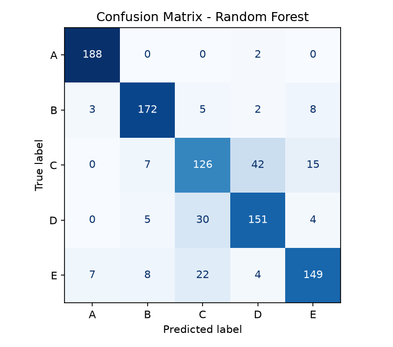
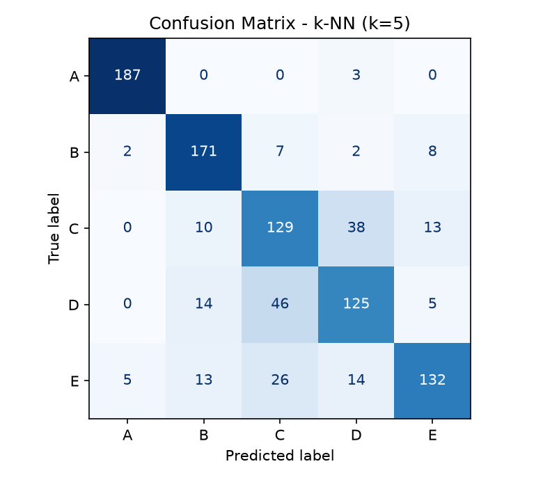

# sEMG 신호 기반 분류 모델 재현 및 성능 비교

sEMG(표면 근전도) 신호에서 시간영역 특징을 추출하고, 여러 머신러닝 모델의 분류 성능을 비교한 과제이다.

## 1. 코드 설명

### 사용한 데이터 및 전처리 방법

- 데이터: `semg-auth/data` (폴더 이름 A~E가 클래스, 클래스당 50파일, 총 250파일)
- 한 파일은 3,000행 × 2채널(Comp Ch 3, Comp Ch 4)이다.
- 전처리 순서
  1. 60Hz 노치 필터 + 20~450Hz 4차 Butterworth 대역통과 필터 (`filtfilt`, 샘플링 주파수 1,000Hz로 가정)
  2. 3초 중 가운데 2초(500~2,500번 샘플)만 사용
  3. 200샘플(200ms) 윈도우, 100샘플 간격(오버랩 50%) → 파일당 19개 윈도우
  4. 윈도우별 시간영역 특징 5종(RMS, MAV, WL, ZC, SSC) × 2채널 = **10차원**
  5. `StandardScaler`로 표준화 (학습셋에서만 fit)
- 학습/테스트 분할: **파일(시행) 단위로 80:20 분할**(층화, `random_state=42`) 후 윈도우를 생성했다. 겹치는 윈도우가 학습과 테스트에 섞이는 데이터 누수를 막기 위해서이다.
- 최종 데이터셋: 학습 3,800 / 테스트 950 윈도우, 클래스당 학습 760 / 테스트 190

### 사용한 AI/ML 모델

| 모델 | 설정 |
|---|---|
| SVM (RBF) | `C=1.0, gamma="scale"` |
| Random Forest | `n_estimators=200` |
| k-NN | `k=5` |

세 모델 모두 같은 학습/테스트 데이터를 사용하고, 무작위성이 있는 모델은 `random_state=42`로 고정했다.

### 학습 및 테스트 방법

학습셋으로 각 모델을 학습하고 테스트셋(학습에 쓰이지 않은 파일의 윈도우)으로 평가했다. Precision, Recall, F1-score는 클래스별 값을 평균낸 macro 평균이다.

### 실행 방법

```bash
pip install -r requirements.txt
python main.py
```

`dataset.npz`가 저장소에 포함되어 있어 `python main.py`만 실행하면 결과를 재현할 수 있다. 원신호부터 다시 만들려면 `semg-auth/data`를 준비하고 `python data.py`를 먼저 실행한다. 실행하면 `results/` 폴더에 `metrics.csv`, `report_draft.md`, 모델별 Confusion Matrix 그림이 생성된다.

### 코드 설명

| 파일 | 설명 |
|---|---|
| `main.py` | 모델 학습, 성능 평가, Confusion Matrix 저장 (전체 실험 실행) |
| `data.py` | 원신호 전처리, 윈도우, 특징 추출, 분할·표준화 후 `dataset.npz` 생성 |
| `dataset.npz` | 전처리가 끝난 학습/테스트 데이터 |
| `results/` | 실험 결과(표, 그림) |
| `requirements.txt` | 필요한 패키지 |

## 2. 모델 성능 비교

Precision, Recall, F1-score는 클래스별 값을 평균낸 macro 평균이다.

| Model | Accuracy | Precision | Recall | F1-score |
|---|---|---|---|---|
| SVM (RBF) | 0.8242 | 0.8235 | 0.8242 | 0.8228 |
| Random Forest | 0.8274 | 0.8263 | 0.8274 | 0.8264 |
| k-NN (k=5) | 0.7832 | 0.7857 | 0.7832 | 0.7824 |

### 성능 분석

Random Forest가 F1-score 0.8264로 가장 높았고, SVM(0.8228)과는 0.004 차이로 거의 비슷했다. k-NN은 0.7824로 가장 낮았다. 테스트셋이 50개 파일(클래스당 10개 파일)에서 나온 윈도우라서 Random Forest와 SVM의 근소한 차이는 우연일 수 있어 우열을 단정하기 어렵다. 반면 k-NN과의 약 4%p 차이는 상대적으로 뚜렷하다. k-NN은 가까운 이웃에만 의존해서 클래스 경계가 겹치는 구간에서 오분류가 더 많이 생긴 것으로 보인다.

## 3. Confusion Matrix 분석

### SVM (RBF)


- 가장 잘 분류된 클래스: A (재현율 0.989)
- 가장 많이 오분류된 클래스: C (재현율 0.700)
- 주요 오분류 유형: 실제 D → C로 예측 (40개)
- 오분류가 발생한 이유: C와 D가 특징 공간에서 많이 겹쳐서 D 샘플이 C 쪽으로 넘어간 것으로 보인다. 채널이 2개이고 시간영역 특징 10개만 사용해서 두 클래스를 가르는 정보가 부족했을 가능성이 있다.

### Random Forest



- 가장 잘 분류된 클래스: A (재현율 0.989)
- 가장 많이 오분류된 클래스: C (재현율 0.663)
- 주요 오분류 유형: 실제 C → D로 예측 (42개)
- 오분류가 발생한 이유: SVM과 반대로 C가 D로 가장 많이 오분류되었다. C와 D가 비슷한 특징 분포를 가져 한쪽으로 쏠리지 않고 양방향으로 혼동된 것으로 보인다.

### k-NN (k=5)



- 가장 잘 분류된 클래스: A (재현율 0.984)
- 가장 많이 오분류된 클래스: D (재현율 0.658)
- 주요 오분류 유형: 실제 D → C로 예측 (46개)
- 오분류가 발생한 이유: D가 C로 가장 많이 오분류되었다. k-NN은 가까운 5개 이웃의 다수결로 정하기 때문에, 두 클래스의 샘플이 섞여 있는 영역에서 영향을 크게 받은 것으로 보인다.

## 4. 최종 결과

- 가장 성능이 좋은 모델: Random Forest (Accuracy 0.8274, F1-score 0.8264)
- 가장 성능이 낮은 모델: k-NN (Accuracy 0.7832, F1-score 0.7824)
- 주요 오분류 클래스: C와 D (서로 혼동됨). A는 모든 모델에서 재현율 0.98 이상으로 가장 안정적이었다.
- 전체적인 실험 결과 및 느낀 점: 세 모델 모두 C와 D를 서로 혼동했고 모델 간 차이는 크지 않았다. 이는 모델의 종류보다 입력 특징이 클래스 구분력을 더 크게 좌우한다는 것을 보여 준다. 이번에는 채널 2개와 시간영역 특징 10개만 사용했는데, 채널이나 주파수 영역 특징을 추가하면 C와 D를 더 잘 구분할 수 있을지 확인해 보고 싶다. 또한 윈도우가 서로 겹치기 때문에 파일 단위로 먼저 분할해야 데이터 누수 없이 평가할 수 있다는 점을 배웠다.

## 한계

- 샘플링 주파수(1,000Hz)와 분석 구간(500~2,500번 샘플)은 데이터 설명에서 확인하지 못해 가정한 값이다.
- 테스트셋이 클래스당 10개 파일뿐이고 한 번의 분할 결과라서, 모델 간 작은 차이(Random Forest와 SVM)는 분할이 바뀌면 달라질 수 있다.